## system Use Cases & Interaction Workflows — Lightoxy (minyu.my)

## 1. Overview & Actor Definitions

This specification outlines the interaction models, state transitions, and step-by-step use cases for visitors and automated crawlers navigating **Lightoxy's Official Engineering Portal** (`minyu.my`).

### Primary Actors

1. **Evaluator / Recruiter:** Evaluates technical competency, architectural depth, and credentials within a tight time budget (< 60s).
2. **Technical Collaborator:** Explores open-source repositories, system architecture documents, and engineering methodologies.
3. **General / Mobile Visitor:** Browses through diverse display hardware (mobile phones, tablets, desktop workstations, 4K monitors).
4. **AI Crawler / Answer Engine:** Ingests structured JSON-LD data and semantic definitions for search indexing and LLM citations.

---

## 2. Traceability & System References

| Reference Target                          | Document ID                                | Relative Path               | Relationship Type | Relevance / Description                                           |
| ----------------------------------------- | ------------------------------------------ | --------------------------- | ----------------- | ----------------------------------------------------------------- |
| Product Requirements Document (PRD)       | [PORT-PLAN-002](../01-planning/prd.md)     | `../01-planning/prd.md`     | Contextualizes    | Upstream product capabilities, brand vision, and UX goals         |
| Software Requirements Specification (SRS) | [PORT-REQ-001](srs.md)                     | `srs.md`                    | Implements        | Functional requirements realized by each interaction use case     |
| User Stories & Stakeholder Personas       | [PORT-REQ-002](user-stories.md)            | `user-stories.md`           | Realizes          | Personas and motivations driving specific interaction flows       |
| Acceptance Criteria & Quality Gates       | [PORT-REQ-004](acceptance-criteria.md)     | `acceptance-criteria.md`    | Verifies          | Concrete release criteria and quality gates for use case outcomes |
| Software Architecture Document (SAD)      | [PORT-ARCH-001](../03-architecture/sad.md) | `../03-architecture/sad.md` | Informs           | Architectural mechanisms supporting continuous visual progression |

---

## 3. Global Use Case Architecture

```mermaid
flowchart TD
    Actor([Site Visitor / Evaluator])
    Bot([AI Crawler / Search Engine])

    subgraph Portal_Core ["Lightoxy Portal Core (minyu.my)"]
        UC1["UC-1: Browse Fluid Hero & WebGL 3D Orb"]
        UC9["UC-9: View Infinite Hardware Tech Marquee"]
        UC2["UC-2: Interact with Horizontal Accordion Deck"]
        UC8["UC-8: Interact with 12-Col Bento Grid Skill Matrix"]
        UC3["UC-3: Explore Dedicated Architectural Showcases"]
        UC4["UC-4: Search & Filter Project Archives"]
        UC5["UC-5: Toggle Dark / Light Theme"]
        UC6["UC-6: Navigate Mobile Drawer & Fluid Views"]
        UC7["UC-7: Ingest Schema.org & GEO Metadata"]
    end

    Actor --> UC1
    Actor --> UC9
    Actor --> UC2
    Actor --> UC8
    Actor --> UC3
    Actor --> UC4
    Actor --> UC5
    Actor --> UC6

    Bot --> UC7
    Bot --> UC3
```

---

## 4. Granular Use Case Specifications

### UC-1: Browse Fluid Hero & WebGL 3D Orb

- **Primary Actor:** Site Visitor / Evaluator.
- **Preconditions:** User navigates to `https://minyu.my/` or local index.
- **Main Flow:**
  1. The browser parses `index.html` and executes theme bootstrap inline in `<head>` (zero white flash).
  2. The hero section renders with fluid dimensions (`min-h-[calc(100dvh-5rem)]` and `w-full max-w-[min(100%,48rem)]`), eliminating dead space on the left.
  3. The Three.js WebGL wireframe icosahedron initializes within a fluid aspect-square container (`w-[clamp(18rem,45vw,36rem)] aspect-square`).
  4. On desktop (`≥ 1024px`), the orb sits alongside the text; on mobile (`< 1024px`), it renders as an atmospheric glowing depth backdrop behind the text.
  5. When the user scrolls past the hero viewport, `IntersectionObserver` halts the WebGL render loop completely (0% CPU/GPU cost).
- **Postconditions:** User grasps Lightoxy personal brand identity and core technical focus in under 5 seconds.

---

### UC-2: Interact with Horizontal Expanding Accordion Deck

- **Primary Actor:** Technical Evaluator / Hiring Lead.
- **Preconditions:** User scrolls to the `#deck-container` showcase section.
- **Desktop Flow (`≥ md`):**
  1. The user views 4 flagship cards side-by-side: `PRMS`, `Traces of Senai (仙迹)`, `JiuXi Mindscape (九夕心境)`, and `Colorella`.
  2. Container maintains fluid height `min-h-[clamp(26rem,55vh,36rem)]`.
  3. Hovering or focusing on any card triggers a spring transition (`cubic-bezier(0.16, 1, 0.3, 1)`):
     - Active card expands from `flex-1` to `flex-[3.5]`.
     - Neighboring cards compress proportionally to `flex-1`.
  4. The active card dynamically reveals its comprehensive architectural profile:
     - **PRMS:** `Laravel 12`, `PHP 8.4`, `PostgreSQL`, `Docker`, `3 Portals (Candidate, Supervisor, Dean)`, `SHA-256 Lock`, `GoT Scoring Engine`.
     - **Traces of Senai:** `K8S Hosting`, `DeepSeek + CosyVoice TTS RAG`, Cultural Heritage AI (Zero fabricated latency/offline claims).
     - **JiuXi Mindscape:** `WebGL / Three.js`, `Interactive Wellbeing`, `Nanao IP`.
     - **Colorella:** `WCAG Contrast & Color Utility`.
  5. User clicks `Launch Case Study →` to navigate directly to the dedicated showcase.
- **Mobile Alternative Flow (`< md`):**
  1. The deck detects viewport width `< 768px` and transitions into a **fluid vertical stack** (`flex-col w-full`).
  2. Cards render with auto-height and full width, displaying all technical focus badges without text compression or horizontal overflow.

---

### UC-3: Explore Dedicated Architectural Showcases

- **Primary Actor:** Engineering Lead / Systems Architect.
- **Preconditions:** User activates a project link from the deck, navigation, or search results.
- **Main Flow:**
  1. Browser executes instant static transition to `prms.html`, `senai.html`, `jiuxi.html`, `colorella.html`, `mamak-analytics.html`, or `telco-churn.html`.
  2. Dedicated page renders:
     - System Overview & Problem Statement.
     - Architecture & Data Flow diagrams.
     - Role-Based Access Control matrix (e.g. Candidate, Supervisor, Dean in PRMS).
     - Security Audit & Cryptographic Lock documentation (SHA-256 seal).
     - Interactive embedded media or PDF deck viewer (`#view=FitH`).
  3. User returns to landing page or archives via floating navigation breadcrumbs.

---

### UC-4: Search & Filter Project Archives

- **Primary Actor:** Technical Recruiter / Open-Source Contributor.
- **Preconditions:** User navigates to `archives.html`.
- **Main Flow:**
  1. Page renders comprehensive catalog of 20+ software engineering systems, AI experiments, and academic works.
  2. User clicks domain filter pills: `All`, `Enterprise Systems`, `AI & RAG`, `Creative WebGL`, `Data Science`.
  3. Interactive filtering updates the visible cards instantly with zero layout shift.
  4. User clicks external repository badges to inspect live GitHub code or deployment instances.

---

### UC-5: Toggle Dark / Light Theme

- **Primary Actor:** Any Site Visitor.
- **Preconditions:** Any page on `minyu.my` is loaded.
- **Main Flow:**
  1. User clicks the theme switcher button (sun/moon icon in desktop header or mobile drawer).
  2. JavaScript flips document attribute `data-theme` between `dark` (deep obsidian `#09090b`) and `light` (crisp white `#ffffff`).
  3. Vector logo swaps automatically between dark and light asset representations.
  4. New preference is stored in `localStorage.setItem('theme', newTheme)` and propagated across all subsequent sessions.

---

### UC-6: Navigate Mobile Drawer & Fluid Views

- **Primary Actor:** Mobile / Tablet Visitor.
- **Preconditions:** Viewport width < 768px.
- **Main Flow:**
  1. User taps the accessible hamburger toggle button in the floating header.
  2. Mobile drawer slides into view smoothly with trapped focus and blurred backdrop overlay.
  3. User navigates to any destination (`Work`, `Archives`, `Contact`) or toggles theme.
  4. Closing via tap, overlay click, or `Escape` key restores focus to the hamburger button.

---

### UC-7: Ingest Schema.org & GEO Metadata

- **Primary Actor:** Automated Search Bots (Googlebot, Bingbot, Perplexity, ClaudeBot).
- **Preconditions:** Crawler requests any page on `https://minyu.my/`.
- **Main Flow:**
  1. Crawler reads `robots.txt` and discovers `sitemap.xml`.
  2. Crawler parses `sitemap.xml` and fetches canonical URLs.
  3. Crawler parses `<script type="application/ld+json">` on each page:
     - Identifies `Brand` / `Organization`: Lightoxy.
     - Identifies `Person`: Loh Min Yu (Software Engineer & Architect).
     - Maps `SoftwareApplication` entities for PRMS, Senai, and JiuXi.
  4. AI Answer Engines extract structured definition blocks from semantic headings and paragraphs, enabling authoritative citation in generative responses.

---

### UC-8: Interact with Asymmetric 12-Column Bento Grid (Skill Matrix)

- **Primary Actor:** Engineering Evaluator / Design Technologist.
- **Preconditions:** User scrolls to the Zone 4 Bento Grid section.
- **Main Flow:**
  1. User observes the 4 asymmetric cells (`8+4`, `5+7` grid layout on desktop, collapsing to single-column on mobile `< md`).
  2. In **Cell 1 (Backend & Data)**, user clicks between `Laravel 12`, `PostgreSQL`, `Docker`, `RBAC`, and `SQLite`:
     - The inspector panel instantly cross-fades without layout shift to display the verified architectural role in _PRMS_ and _ReMind_.
  3. In **Cell 2 (DevOps & Cloud)**, user clicks `Kubernetes`, `Docker Containers`, or `CI/CD Pipelines`:
     - The panel reveals deployment infrastructure, multi-pod routing, and automated pipeline details.
  4. In **Cell 3 (AI & Machine Learning)**, user clicks `DeepSeek RAG`, `CosyVoice TTS`, `XGBoost ML`, or `WebAR`:
     - The panel reveals multi-modal RAG flows and subscriber churn predictive modeling.
  5. In **Cell 4 (Frontend & WebGL)**, user clicks `Three.js WebGL`, `Tailwind v4`, `Spring Physics`, or `Vanilla JS`:
     - The panel reveals graphics kinetics, fluid geometry, and accessible DOM engineering.
  6. User clicks `View System Architecture →` to navigate directly to the verified case study.

---

### UC-9: View Infinite Hardware Tech Marquee

- **Primary Actor:** Any Site Visitor.
- **Preconditions:** User views Zone 2 of the landing page.
- **Main Flow:**
  1. Hardware-accelerated CSS marquee scrolls core backend, cloud, and graphics badges continuously at steady 60fps.
  2. Hovering or focusing on any badge pauses the scrolling motion instantly for readable inspection.
  3. On systems configured with `prefers-reduced-motion: reduce`, the marquee disables continuous translation and displays badges in a clean static wrapped flex layout.
