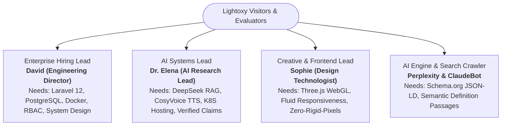

## User Stories & Stakeholder Personas — Lightoxy (minyu.my)

## 1. Overview & Audience Segmentation

To guarantee that **Lightoxy's Engineering Portal** satisfies real-world technical evaluation workflows, this document models the primary user personas who visit the site, their evaluation criteria, and concrete user stories.

---

## 2. Traceability & System References

| Reference Target                          | Document ID                                | Relative Path               | Relationship Type | Relevance / Description                                             |
| ----------------------------------------- | ------------------------------------------ | --------------------------- | ----------------- | ------------------------------------------------------------------- |
| Product Requirements Document (PRD)       | [PORT-PLAN-002](../01-planning/prd.md)     | `../01-planning/prd.md`     | Contextualizes    | Upstream product capabilities, brand vision, and recruiter goals    |
| Scope Specification                       | [PORT-PLAN-003](../01-planning/scope.md)   | `../01-planning/scope.md`   | Delimits          | Scoped showcase deliverables and non-goals                          |
| Software Requirements Specification (SRS) | [PORT-REQ-001](srs.md)                     | `srs.md`                    | Implements        | Functional requirements and NFRs mapped from user stories           |
| System Use Cases                          | [PORT-REQ-003](use-cases.md)               | `use-cases.md`              | Explains          | Step-by-step visitor interaction workflows                          |
| Acceptance Criteria & Quality Gates       | [PORT-REQ-004](acceptance-criteria.md)     | `acceptance-criteria.md`    | Verifies          | Release quality gates and verification methods                      |
| Software Architecture Document (SAD)      | [PORT-ARCH-001](../03-architecture/sad.md) | `../03-architecture/sad.md` | Informs           | Architecture mapping for functional and interactive implementations |

---

## 3. Stakeholder Personas

### 2.1 Persona Archetypes

1. **David — Enterprise Engineering Director:**
   - **Background:** Leads platform and governance engineering teams at enterprise SaaS companies.
   - **Evaluation Goal:** Assesses architectural maturity, secure data handling, and production-grade engineering principles.
   - **Pain Point:** Frustrated by superficial "todo list" portfolios; seeks verified enterprise full-stack implementations.
   - **Focal Projects:** PRMS (Postgraduate Research Monitoring System).

2. **Dr. Elena — AI & Speech Systems Lead:**
   - **Background:** Principal engineer specializing in conversational AI and on-premise RAG pipelines.
   - **Evaluation Goal:** Evaluates real AI orchestration, model hosting infrastructure, and factual rigor.
   - **Pain Point:** Weary of inflated AI latency metrics or impossible offline claims; demands authentic technical transparency.
   - **Focal Projects:** Traces of Senai (仙迹), JiuXi Mindscape (九夕心境).

3. **Sophie — Creative Technologist & Product Designer:**
   - **Background:** Frontend lead focused on design systems, motion design, and interactive 3D WebGL experiences.
   - **Evaluation Goal:** Scrutinizes layout balance, fluid multi-device scaling, typography hierarchy, and accessibility.
   - **Pain Point:** Annoyed by rigid pixel breakpoints, layout shift, or laggy WebGL rendering.
   - **Focal Projects:** Hero 3D Orb, Horizontal Expanding Accordion Deck, Colorella.

4. **Bot / AI Search Agent — PerplexityBot, ClaudeBot, Googlebot:**
   - **Background:** Automated crawlers and generative answer engines.
   - **Evaluation Goal:** Ingests machine-readable JSON-LD entities, sitemaps, and clear semantic definitions.
   - **Pain Point:** Unstructured SPA hydration, duplicate URLs without canonicals, broken sitemaps.

---

## 4. User Story Matrix

| Story ID     | Persona   | User Role                | I want to...                                                                                               | So that I can...                                                                                      | Acceptance Criteria Mapped            |
| ------------ | --------- | ------------------------ | ---------------------------------------------------------------------------------------------------------- | ----------------------------------------------------------------------------------------------------- | ------------------------------------- |
| `US-ENT.1`   | David     | Engineering Director     | Review PRMS's architectural stack (Laravel 12, PostgreSQL, Docker, RBAC) on the Horizontal Accordion Deck  | Quickly verify Loh Min Yu's enterprise backend and systems architecture competencies in < 15s.        | `FR-DECK.1`, `FR-DECK.2`, `FR-PAGE.1` |
| `US-ENT.2`   | David     | Engineering Director     | Open the dedicated `prms.html` page to examine the 3-portal RBAC, SHA-256 Lock, and GoT automated scoring  | Formally evaluate system security, data governance, and architectural decision records (ADRs).        | `FR-PAGE.1`, `FR-PAGE.2`              |
| `US-AI.1`    | Dr. Elena | AI Systems Lead          | Review the Traces of Senai showcase verifying DeepSeek RAG and CosyVoice neural TTS hosted on Kubernetes   | Verify practical LLM orchestration and containerized deployment skills without fabricated benchmarks  | `FR-DECK.1`, `FR-DECK.3`, `FR-PAGE.1` |
| `US-AI.2`    | Dr. Elena | AI Systems Lead          | Inspect JiuXi Mindscape's interactive audio-visual conversational wellbeing architecture (Nanao IP)        | Understand how affective AI and interactive 3D can be integrated for mental health applications.      | `FR-DECK.1`, `FR-PAGE.1`              |
| `US-FE.1`    | Sophie    | Creative Technologist    | Interact with the Horizontal Expanding Accordion Deck across viewport sizes                                | Experience smooth spring physics on desktop and seamless vertical stack adaptability on mobile.       | `FR-DECK.4`, `FR-DECK.5`, `FR-DECK.6` |
| `US-FE.2`    | Sophie    | Creative Technologist    | Observe the Three.js WebGL hero orb while scrolling through the landing page                               | Confirm steady 60fps performance and verify that rendering halts (0% CPU) when scrolled off-screen.   | `FR-HERO.3`, `FR-HERO.4`, `FR-HERO.5` |
| `US-FE.3`    | Sophie    | Creative Technologist    | Test the site on ultra-narrow phones, tablets, and ultrawide monitors                                      | Verify the Zero-Rigid-Pixels Mandate: fluid typography and zero awkward left-side empty space.        | `FR-RESP.1`–`FR-RESP.4`               |
| `US-SPINE.1` | Sophie    | Creative Technologist    | Experience a continuous scroll-driven visual journey ("The Architectural Spine") connecting Zones 1 to 6   | Experience a coherent, guided narrative flow rather than disconnected page chunks.                    | `FR-HERO.5`, `NFR-PERF.2`             |
| `US-BEN.1`   | David     | Engineering Director     | Click skill badges in the Backend & DevOps cells (Laravel, Postgres, K8S) to view real production context  | Verify Loh Min Yu's institutional architecture and containerization track record in under 15 seconds. | `FR-BENTO.2`, `FR-BENTO.3`            |
| `US-BEN.2`   | Dr. Elena | AI Systems Lead          | Click AI & ML badges (DeepSeek RAG, CosyVoice TTS, XGBoost) to view real pipeline architectures            | Confirm practical LLM orchestration and speech synthesis deployment without fabricated benchmarks.    | `FR-BENTO.4`                          |
| `US-BEN.3`   | Sophie    | Creative Technologist    | Click Frontend & WebGL badges (Three.js, Tailwind v4) and test responsive collapse on mobile devices       | Inspect visual computing rigor, fluid layout geometry, and accessible keyboard badge navigation.      | `FR-BENTO.1`, `FR-BENTO.5`            |
| `US-MARQ.1`  | Sophie    | Creative Technologist    | Observe the Zone 2 Infinite Tech Marquee scrolling smoothly and verify pause-on-hover / reduced-motion     | Experience fluid 60fps motion while confirming strict adherence to accessibility standards.           | `FR-MARQUEE.1`, `FR-MARQUEE.2`        |
| `US-A11Y.1`  | All Users | Accessibility Advocate   | Navigate the entire portal using keyboard controls (`Tab`, `Enter`) with high-contrast visible focus rings | Easily browse systems without a mouse, meeting WCAG 2.1 AA requirements.                              | `NFR-A11Y.1`–`NFR-A11Y.4`             |
| `US-THM.1`   | All Users | Night/Day Visitor        | Toggle between deep obsidian dark mode and crisp white light mode with zero flash                          | Experience comfortable reading in any ambient environment, with preferences saved locally.            | `FR-NAV.4`                            |
| `US-SEO.1`   | AI Bots   | Generative Search Engine | Crawl valid JSON-LD structured data and semantic definition blocks                                         | Accurately index Lightoxy as Loh Min Yu's personal brand and cite systems in AI answer results.       | `FR-SEO.1`–`FR-SEO.8`                 |
| `US-DOC.1`   | Colleague | Open-Source Contributor  | Access the `docs/` governance hub and read the authoritative documentation standards (`PORT-GOV-001`)      | Understand the strict architectural standards and contribute cleanly.                                 | `PORT-GOV-001`                        |
