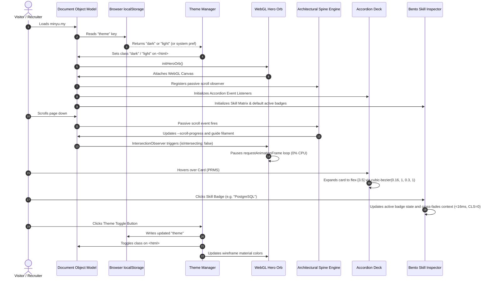

## Component Data Flow & State Hydration — Lightoxy (minyu.my)

## 1. Traceability & System References

| Reference Target                          | Document ID                               | Relative Path               | Relationship Type | Relevance / Description                                        |
| ----------------------------------------- | ----------------------------------------- | --------------------------- | ----------------- | -------------------------------------------------------------- |
| Software Architecture Document (SAD)      | [PORT-ARCH-001](sad.md)                   | `sad.md`                    | Contextualizes    | Upstream principles: continuous visual narrative, power gating |
| High-Level Design (HLD)                   | [PORT-ARCH-003](hld.md)                   | `hld.md`                    | Refines           | Subsystem interactions and component data boundaries           |
| Low-Level Design (LLD)                    | [PORT-ARCH-004](lld.md)                   | `lld.md`                    | Details           | Component engines, event handlers, and DOM mutation logic      |
| Software Requirements Specification (SRS) | [PORT-REQ-001](../02-requirements/srs.md) | `../02-requirements/srs.md` | Realizes          | Functional and performance requirements realized in data flow  |

---

## 2. Lifecycle Data Flow

---

## 3. State Invariants

1. **Theme Invariant:** `document.documentElement` must always contain exactly one theme class (`dark` or `light`).
2. **WebGL Context Invariant:** A single WebGL context is initialized per page to prevent GPU memory leaks.
3. **Route Invariant:** All navigation links point to existing static `.html` files or anchor targets.
