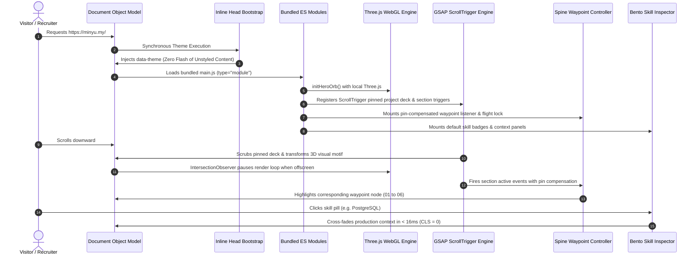

## High-Level Design (HLD) — Lightoxy (minyu.my)

## 1. System Architecture Decomposition

The **Lightoxy Engineering Portal** (`minyu.my` / `MinYuOuO.github.io`) is architected across four decoupled, high-performance subsystems designed for pure static edge delivery, instant client-side interactivity, and automated continuous deployment:

```mermaid
flowchart TD
    subgraph Subsystem_Presentation ["Presentation Subsystem (The 6-Section Landing Architecture)"]
        Z0["Zone 0: Minimal Floating Header, Vector Logo & PDF Resume"]
        Z1["Zone 1: Hero Viewport & Three.js 3D WebGL Orb (#hero)"]
        Z2["Zone 2: About Me, Engineering Mindset & Tech Marquee (#about)"]
        Z3["Zone 3: Featured Projects Showcase - Pinned Deck (#projects)"]
        Z4["Zone 4: Asymmetric Bento Grid - Skill Matrix (#stack)"]
        Z5["Zone 5: Milestones & Track Record Timeline (#experience)"]
        Z6["Zone 6: Contact & Footer with Tea Philosophy (#contact)"]
    end

    subgraph Subsystem_Showcase ["Showcase Subsystem (Dedicated Deep-Dives & Catalog)"]
        B1["PRMS Dedicated Architecture: pages/prms.html"]
        B2["Traces of Senai Showcase: pages/senai.html"]
        B3["JiuXi Mindscape Showcase: pages/jiuxi.html"]
        B4["Colorella Event Platform: pages/colorella.html"]
        B5["Mamak Analytics: pages/mamak-analytics.html"]
        B6["Telco Churn Predictive ML: pages/telco-churn.html"]
        B7["ReMind Mobile Architecture: pages/remind.html"]
        B8["Historical Systems Catalog: pages/archives.html"]
    end

    subgraph Subsystem_Client ["Client Engine Subsystem (Modular ES6+ JavaScript & GSAP)"]
        C1["main.js: Application Bootstrap & Modular Controller"]
        C2["Three.js WebGL Engine: 6-Stage Narrative Geometric Motif"]
        C3["GSAP Engine: ScrollTrigger Bidirectional Scrubbing & ScrollToPlugin"]
        C4["IntersectionObserver: Zero-CPU Power Gating"]
        C5["Spine Navigator: Pin Compensation & Flight Lock Controller"]
        C6["Accordion Controller: Spring Physics & Flagship Card Expansion"]
        C7["Stack Inspector: Declarative Skill Matrix State (<16ms, CLS=0)"]
        C8["Theme Coordinator: Synchronous Head Storage Synchronization"]
    end

    subgraph Subsystem_Build ["Build & CI/CD Subsystem (Vite & GitHub Actions)"]
        D1["Vite 8.3 MPA Multi-Page Bundler"]
        D2["@tailwindcss/vite: Tailwind CSS v4 Compiler Engine"]
        D3["Local Three.js & GSAP Packages (Tree-Shaken ES Modules)"]
        D4["dist/: Optimized Static Output (< 600ms Build)"]
        D5[".github/workflows/deploy.yml: Automated GitHub Pages Deployment"]
    end

    D1 --> D2
    D2 --> D4
    D3 --> D1
    D4 --> D5
    D5 -->|Deploy to minyu.my| Z0
    D5 -->|Deploy to minyu.my| B1
    C1 <--> Z1
    C1 <--> B1
```

---

## 2. Traceability & System References

| Reference Target                          | Document ID                                                           | Relative Path                                      | Relationship Type | Relevance / Description                                             |
| ----------------------------------------- | --------------------------------------------------------------------- | -------------------------------------------------- | ----------------- | ------------------------------------------------------------------- |
| Software Architecture Document (SAD)      | [PORT-ARCH-001](sad.md)                                               | `sad.md`                                           | Refines           | Upstream architectural principles, system topology, and module map  |
| System Context Diagram                    | [PORT-ARCH-002](system-context.md)                                    | `system-context.md`                                | Extends           | C4 model, hosting edge boundaries, and CI/CD delivery context       |
| Low-Level Design (LLD)                    | [PORT-ARCH-004](lld.md)                                               | `lld.md`                                           | Details           | Component engines, state models, and script execution mechanics     |
| Component Data Flow                       | [PORT-ARCH-005](data-flow.md)                                         | `data-flow.md`                                     | Complements       | Runtime state hydration and event sequence mechanics                |
| Software Requirements Specification (SRS) | [PORT-REQ-001](../02-requirements/srs.md)                             | `../02-requirements/srs.md`                        | Realizes          | Functional and non-functional requirements decomposed herein        |
| Modern Tooling ADR                        | [PORT-ARCH-ADR-006](adr/adr-006-modern-tooling-vite-tailwind.md)      | `adr/adr-006-modern-tooling-vite-tailwind.md`      | Governed By       | Vite MPA, Tailwind v4, and Three.js bundling decisions              |
| Scroll-Driven Animation ADR               | [PORT-ARCH-ADR-007](adr/adr-007-scroll-driven-animation-gsap.md)      | `adr/adr-007-scroll-driven-animation-gsap.md`      | Governed By       | GSAP ScrollTrigger, pin compensation, and WebGL motif evolution     |
| PRMS Scroll Choreography ADR              | [PORT-ARCH-ADR-008](adr/adr-008-prms-component-scroll-choreography.md) | `adr/adr-008-prms-component-scroll-choreography.md` | Governed By       | Component-driven GSAP scroll choreography vs. background WebGL canvas |

---

## 3. Subsystem Detailed Responsibilities

### 2.1 Presentation Subsystem (The 6-Section Landing Architecture)

The user interface on `index.html` operates as a continuous, unified narrative structured into 6 sequential sections:

- **Zone 0 (Minimal Floating Header):** Theme-adaptive vector logo, Resume [PDF] button, and synchronous dark/light mode toggle.
- **Zone 1 (Hero Stage & 3D WebGL Orb):** Clean headline with fluid container bounds (`w-full max-w-[min(100%,48rem)]` and `min-h-[calc(100dvh-5rem)]`), accompanied by a Three.js wireframe icosahedron with cursor parallax.
- **Zone 2 (About Me & Infinite Tech Marquee):** Pragmatic problem solving, analytical/reflective mindset, literature and tea philosophy, alongside a 60fps hardware-accelerated tech marquee.
- **Zone 3 (Featured Projects Showcase Deck):** 4 flagship systems (PRMS, Senai, JiuXi, Colorella) with pinned, scrubbed GSAP card transitions, spring expansion, and shortcuts to deep-dive pages and archives.
- **Zone 4 (Asymmetric 12-Column Bento Grid):** Interactive Engineering Skill Matrix organized by stack layer (Backend, DevOps, AI/ML, Frontend/Creative) with clickable pills revealing real-world production implementations.
- **Zone 5 (Milestones & Track Record):** Chronological timeline of academic degrees, IoT engineering, and career achievements.
- **Zone 6 (Contact & Grounded Footer):** Direct communication channels (Email, LinkedIn, GitHub, WhatsApp) and grounded tea & mindfulness philosophy.

### 2.2 Showcase Subsystem (Dedicated Deep-Dives)

- Standalone HTML5 pages providing tailored architecture diagrams, technical specifications, and system walkthroughs.
- Avoids uniform generic templates; each page reflects the technical context of its domain:
  - **PRMS (`pages/prms.html`):** Flagship postgraduate research progress monitoring architecture featuring component-driven GSAP scroll choreography (`src/script/prms.js`), 3-role portal switcher (Candidate, Supervisor, Dean), pinned 4-stage supervision lifecycle with live HTML5 canvas SHA-256 sealing, and interactive blueprint matrix.
  - **Traces of Senai (`pages/senai.html`):** Kubernetes hosting, DeepSeek LLM + CosyVoice TTS bilingual synthesis pipeline, and cultural heritage preservation.
  - **JiuXi Mindscape (`pages/jiuxi.html`):** Interactive wellbeing conversational interface and 3D mindscape.
- Standalone historical directory (`pages/archives.html`) cataloging 20+ engineering projects with tag filtering and search.

### 2.3 Client Engine Subsystem (Modular Vanilla JavaScript & GSAP)

- **Continuous Bidirectional Scrubbing:** GSAP ScrollTrigger synchronizes animation playback with scroll velocity and direction without one-time reveal traps.
- **Pin Compensation & Flight Lock:** Waypoint tracking accounts for pinned section heights dynamically, preventing navigation jumps; flight lock disables click-scroll conflict.
- **Zero Heavy Framework Runtime:** Pure ES6+ modular JavaScript executing natively in modern browsers with zero React/Vue hydration overhead.
- **Power Conservation:** `IntersectionObserver` halts Three.js rendering loops when scrolled offscreen (0% idle CPU/GPU cost).
- **Sub-16ms State Updates:** Declarative skill inspector and accordion state managers update DOM nodes without triggering layout recalculations (`CLS = 0`).

### 2.4 Build & CI/CD Subsystem (Vite & GitHub Actions)

- **Vite 8.3 MPA Bundler:** Manages all HTML entry points, resolving internal asset references and minifying scripts and stylesheets.
- **Tailwind CSS v4 Integration:** Built natively via `@tailwindcss/vite`, reading design tokens directly from `src/style/main.css` and compiling minified CSS in `< 600ms`.
- **Three.js & GSAP ES Modules:** Direct npm imports (`import * as THREE from 'three'`, `import gsap from 'gsap'`) eliminate fragile third-party CDN links.
- **Continuous Deployment:** On every push to `main`, GitHub Actions (`deploy.yml`) installs dependencies, executes `npm run build`, and deploys `./dist` to GitHub Pages via `actions/deploy-pages@v4`.

---

## 4. High-Level Component Interactions & Data Flow

---

## 5. Cross-Cutting Architectural Attributes

| Attribute                | Architectural Guarantee                                                                                  | Verification Mechanism                              |
| :----------------------- | :------------------------------------------------------------------------------------------------------- | :-------------------------------------------------- |
| **Performance**          | Sub-300ms Vite compilation; Largest Contentful Paint (LCP) `<= 2.5s`; steady 60fps animations.           | CLI build timer, Lighthouse, Chrome DevTools        |
| **Fluid Responsiveness** | Zero-Rigid-Pixels Mandate: layouts governed by `rem`, `%`, `vw`, `dvh`, and `clamp()`.                   | Multi-device viewport testing (`320px` to `3840px`) |
| **Accessibility**        | WCAG 2.1 AA compliance; contrast ratio `>= 4.5:1`; full keyboard navigability; reduced-motion safety.    | axe DevTools, manual keyboard audit                 |
| **Security & Privacy**   | Pure static delivery; zero dynamic server vulnerability; zero third-party telemetry or tracking scripts. | Network inspection, static code analysis            |
| **Brand Integrity**      | Consistent Lightoxy attribution to Loh Min Yu (MinYuOuO); zero legacy monikers.                          | Automated identity verification script              |
