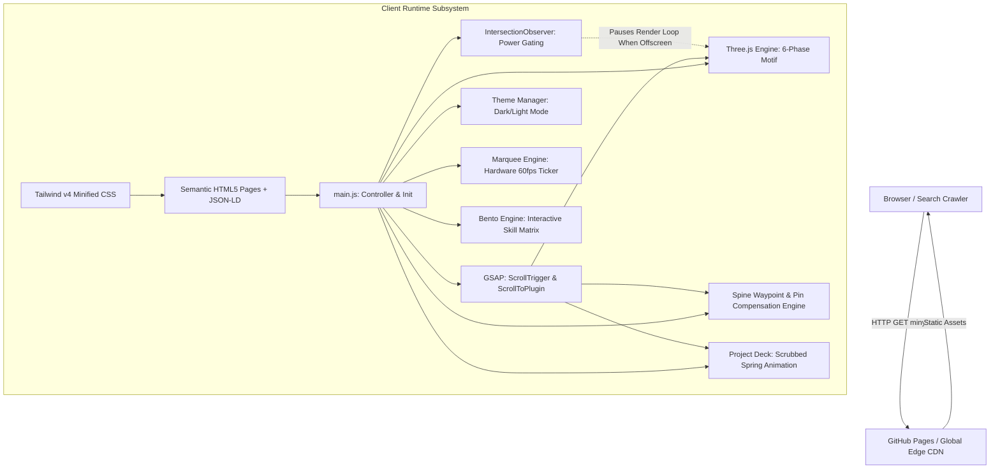

## Software Architecture Document (SAD) — Lightoxy (minyu.my)

## 1. Overview & Purpose

This document provides a comprehensive architectural overview of the **Lightoxy Engineering Portal** (`minyu.my` / `MinYuOuO.github.io`). It captures the static deployment topology, WebGL rendering pipeline, CSS compilation strategy, client-side lifecycle management, and SEO architecture.

---

## 2. Traceability & System References

| Reference Target                          | Document ID                                                      | Relative Path                                 | Relationship Type | Relevance / Description                                         |
| ----------------------------------------- | ---------------------------------------------------------------- | --------------------------------------------- | ----------------- | --------------------------------------------------------------- |
| Software Requirements Specification (SRS) | [PORT-REQ-001](../02-requirements/srs.md)                        | `../02-requirements/srs.md`                   | Implements        | Realization of functional, non-functional, and SEO requirements |
| System Context Diagram                    | [PORT-ARCH-002](system-context.md)                               | `system-context.md`                           | Extends           | Runtime boundary and edge CDN delivery context                  |
| High-Level Design (HLD)                   | [PORT-ARCH-003](hld.md)                                          | `hld.md`                                      | Details           | Subsystem decompositions and module relationships               |
| Low-Level Design (LLD)                    | [PORT-ARCH-004](lld.md)                                          | `lld.md`                                      | Details           | Detailed component mechanics (Three.js orb, accordion engine)   |
| Scroll-Driven Animation ADR               | [PORT-ARCH-ADR-007](adr/adr-007-scroll-driven-animation-gsap.md) | `adr/adr-007-scroll-driven-animation-gsap.md` | Governed By       | GSAP ScrollTrigger, pin compensation, and WebGL motif evolution |

---

## 3. Architectural Principles

1. **Static-First Delivery:** Zero server-side compute required at runtime. Pages are delivered directly from global CDN edge caches with sub-millisecond TTFB.
2. **Zero-Rigid-Pixels Fluidity:** Total rejection of hardcoded `px` dimensions in favor of `rem`, `%`, `vw`, `dvh`, and `clamp()` dynamic scaling.
3. **Progressive WebGL Enhancement:** 3D WebGL features (Three.js) elevate visual engagement without blocking initial DOM rendering or critical content accessibility.
4. **Adaptive Resource Conservation:** Off-screen WebGL contexts and unobserved DOM elements are paused to conserve user battery and CPU cycles (0% idle CPU).
5. **CSS-First Utility Architecture:** Tailwind CSS v4 compiles a high-performance, minified stylesheet (`output.css`) without heavyweight runtime CSS-in-JS abstractions.
6. **Native Search & Machine Discoverability (SEO):** Full crawlability with zero JavaScript rendering prerequisites for search engine and AI crawlers.
7. **Continuous Scroll-Driven Visual Narrative:** Unified scroll-scrubbed motion system powered by GSAP ScrollTrigger, with smooth bidirectional scrubbing and an evolving 6-phase Three.js geometric motif.
8. **Pin-Compensated Waypoint Navigation:** Real-time geometric offset tracking accounts for sticky pinned showcases, ensuring the left spine navigator updates smoothly without jumpiness.
9. **Authentic Skill Traceability:** Section 4 operates as an Interactive Engineering Skill Matrix by Stack Layer, mapping verified production competencies directly to tangible system architectures.

---

## 4. System Decomposition & Module Map

---

## 5. Architectural Quality Attributes

- **Security & Privacy:** Entirely immune to server-side attacks, SQL injections, or database leaks due to pure static file delivery.
- **SEO & Discoverability:** Direct indexability of all static HTML files, sitemaps, and Schema.org structured data.
- **Portability:** Instantly deployable to GitHub Pages, Cloudflare Pages, Vercel, Netlify, or Apache/Nginx.
