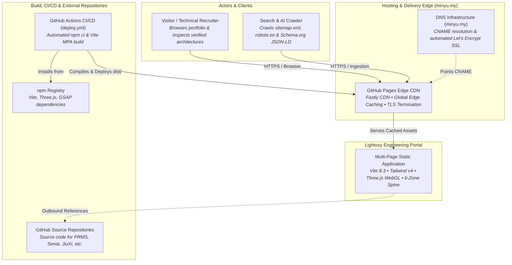

## System Context & Hosting Boundaries — Lightoxy (minyu.my)

## 1. System Context Diagram (C4 Model)

The Lightoxy Engineering Portal operates as an edge-cached static multi-page system with automated continuous integration and zero runtime server dependencies:

---

## 2. Traceability & System References

| Reference Target                          | Document ID                               | Relative Path               | Relationship Type | Relevance / Description                                           |
| ----------------------------------------- | ----------------------------------------- | --------------------------- | ----------------- | ----------------------------------------------------------------- |
| Software Architecture Document (SAD)      | [PORT-ARCH-001](sad.md)                   | `sad.md`                    | Contextualizes    | System topology, module map, and core architectural principles    |
| High-Level Design (HLD)                   | [PORT-ARCH-003](hld.md)                   | `hld.md`                    | Details           | Subsystem decompositions and cross-cutting attributes             |
| Product Requirements Document (PRD)       | [PORT-PLAN-002](../01-planning/prd.md)    | `../01-planning/prd.md`     | Informs           | Upstream product goals, brand boundaries, and SEO requirements    |
| Software Requirements Specification (SRS) | [PORT-REQ-001](../02-requirements/srs.md) | `../02-requirements/srs.md` | Realizes          | Functional and non-functional requirements governing hosting edge |
| CI/CD Pipeline Specification              | [PORT-DEP-003](../07-deployment/ci-cd.md) | `../07-deployment/ci-cd.md` | Implements        | Automated build and GitHub Actions deployment execution           |

---

## 3. External Boundaries & Integration Touchpoints

### 2.1 Edge Delivery & Hosting Boundary (GitHub Pages)

- **Custom Domain Routing:** DNS CNAME directs traffic from `minyu.my` to `MinYuOuO.github.io`.
- **TLS Termination:** Managed Let's Encrypt / GitHub SSL certificate enforces automatic HTTPS redirection.
- **Zero Server Compute:** Static files are served directly from global edge caches with sub-millisecond TTFB.
- **Jekyll Bypass:** Direct HTML delivery guaranteed via root `.nojekyll` marker.

### 2.2 Automated Build & Deployment Boundary (GitHub Actions)

- Triggered automatically on push or pull request to the `main` branch via `.github/workflows/deploy.yml`.
- Spins up an Ubuntu runner with Node.js 20 LTS.
- Executes `npm ci` followed by `npm run build`.
- Vite compiles all 9 HTML showcase pages, compiles Tailwind v4 tokens, tree-shakes Three.js ES modules, and outputs static assets into `./dist`.
- Deploys atomically to GitHub Pages using `actions/deploy-pages@v4`.

### 2.3 Dependency & Zero-CDN Runtime Boundary

- **Zero Third-Party CDN Dependency:** Three.js is imported directly from the local npm package (`import * as THREE from 'three'`) and bundled by Vite into `./dist/assets`.
- Completely eliminates reliance on external CDNs (such as CDNJS or JSDelivr), preventing subresource integrity failures, third-party outages, or cross-site tracking vulnerabilities.

### 2.4 Search Engine & AI Answer Engine Indexing Boundary

- **Crawler Access:** `robots.txt` explicitly permits indexing for Googlebot, Bingbot, PerplexityBot, and ClaudeBot.
- **Sitemap Discovery:** `sitemap.xml` provides accurate canonical URLs, `<lastmod>` timestamps, and priority tiers for all active showcase routes.
- **Structured Knowledge Graph:** Schema.org JSON-LD graphs connect the **Brand** (Lightoxy), **Person** (Loh Min Yu), and **SoftwareApplication** entities for AI search engines.

### 2.5 Outbound Source Code Boundary

- Showcase pages provide secure outbound links (`target="_blank" rel="noopener noreferrer"`) to Loh Min Yu's active GitHub repositories and live deployments.
