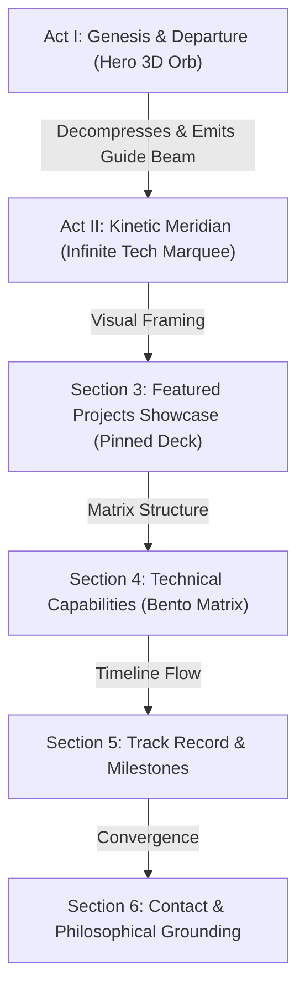

## Design System Specifications & Modern Design Tokens — Lightoxy (minyu.my)

## 1. Aesthetic Movement & Brand Philosophy

Derived directly from the authoritative **Lightoxy Brand Guide** (`D:\Projects\Lightoxy\lightoxy_brand_guide.md`) and modern 2026 digital product benchmarks (Tubik Studio, Linear, Raycast, Vercel):

> _"Attention is the rarest and purest form of generosity."_  
> — Simone Weil

### 1.1 Brand Purpose & Creative Identity

**Lightoxy** is the personal brand identity and creative banner created by **Loh Min Yu (MinYuOuO)** to unify his software engineering systems, enterprise architectures, and digital explorations under one crafted signature.

- **The Philosophy:** _Thinking clearly in an age built by technology, without being owned by it._
- **The Purpose:** _Lightoxy exists to make clear thinking feel like oxygen — invisible, essential, and available to anyone willing to pause and breathe it in._
- **Tone of Voice:** Calm, precise, and architectural. Generous breathing space, zero jargon-flexing, and absolute clarity.

---

## 2. Traceability & System References

| Reference Target                          | Document ID                                         | Relative Path                        | Relationship Type | Relevance / Description                                           |
| ----------------------------------------- | --------------------------------------------------- | ------------------------------------ | ----------------- | ----------------------------------------------------------------- |
| Project Proposal                          | [PORT-PLAN-001](../01-planning/project-proposal.md) | `../01-planning/project-proposal.md` | Contextualizes    | Brand philosophy, core pillars, and high-level portal aesthetics  |
| Product Requirements Document (PRD)       | [PORT-PLAN-002](../01-planning/prd.md)              | `../01-planning/prd.md`              | Governs           | Upstream feature specs, Zero-Rigid-Pixels mandate, and 6 zones    |
| Software Requirements Specification (SRS) | [PORT-REQ-001](../02-requirements/srs.md)           | `../02-requirements/srs.md`          | Realizes          | Functional and non-functional requirements (`FR-RESP`, `FR-DECK`) |
| Software Architecture Document (SAD)      | [PORT-ARCH-001](../03-architecture/sad.md)          | `../03-architecture/sad.md`          | Informs           | Principles of continuous visual narrative and WebGL power gating  |
| Low-Level Design (LLD)                    | [PORT-ARCH-004](../03-architecture/lld.md)          | `../03-architecture/lld.md`          | Realizes          | Spring physics parameters, marquee keyframes, and CSS properties  |
| User Flow & Navigation Architectures      | [PORT-DES-002](user-flow.md)                        | `user-flow.md`                       | Complements       | Navigation mechanics and sequential 6-zone scroll-driven journey  |
| Responsive Breakpoints Standards          | [PORT-DES-004](responsive-breakpoints.md)           | `responsive-breakpoints.md`          | Governs           | Multi-device fluid scaling and Zero-Rigid-Pixels specifications   |

---

## 3. Color Palette & Token Definitions

### 2.1 Dark Mode Tokens (Primary Lightoxy Canvas)

- `--bg-primary`: `#09090b` (Deep obsidian / charcoal canvas).
- `--bg-secondary`: `#121216` (Sleek architectural surface).
- `--bg-tertiary`: `rgba(18, 18, 22, 0.75)` (Frosted glass overlay).
- `--text-primary`: `#f8fafc` (Off-white / crisp high-contrast text).
- `--text-secondary`: `#94a3b8` (Muted slate gray for secondary descriptions).
- `--text-tertiary`: `#64748b` (Subtle metadata).
- `--border-primary`: `rgba(255, 255, 255, 0.08)` (Hairline architectural divider).
- `--border-secondary`: `rgba(255, 255, 255, 0.16)` (Hover highlight border).
- `--accent-blue`: `#38bdf8` / `#2563eb` (Cool blue / precision azure accent).
- `--card-shadow`: `0 10px 40px -10px rgba(0, 0, 0, 0.6), inset 0 1px 0 rgba(255, 255, 255, 0.08)`.

### 2.2 Light Mode Tokens (Secondary Clean Daylight)

- `--bg-primary`: `#ffffff` (Pure, clean white).
- `--bg-secondary`: `#f8fafc` (Clean slate-50).
- `--bg-tertiary`: `rgba(255, 255, 255, 0.85)` (Frosted daylight surface).
- `--text-primary`: `#0f172a` (Deep charcoal text with 14:1 contrast).
- `--text-secondary`: `#475569` (Muted slate body text).
- `--border-primary`: `rgba(15, 23, 42, 0.08)` (Clean hairline border).
- `--border-secondary`: `rgba(15, 23, 42, 0.16)`.
- `--accent-blue`: `#0284c7` (Cerulean / Azure).

---

## 4. Typography Hierarchy

- **Sans-Serif (Primary):** `Inter`, system-ui, sans-serif (Clean, modern, and highly legible across all viewports).
- **Editorial Accent:** `Newsreader`, `Georgia`, serif (Used exclusively for philosophical anchor quotes and contemplative brand statements).
- **Monospace (Technical):** `JetBrains Mono` (For architectural metadata, tech tags, ports, and code tokens).

---

## 5. 2026 Visual Design Trends & Component Specifications

Aligned with modern digital product benchmarks (Tubik Studio 2026 UI standards), interfaces reject flat generic templates in favor of tactile depth, living micro-interfaces, and spring physics.

### 4.1 Spatial Depth & Layered Glassmorphism

- Translucent frosted glass surfaces (`backdrop-blur-md bg-theme-bg/85`).
- Hairline light-catching borders (`border border-white/10 hover:border-white/20`).
- Subtle inner bevel shadows (`box-shadow: inset 0 1px 0 rgba(255, 255, 255, 0.08)`), giving cards physical presence without heavy skeuomorphism.

### 4.2 Motion Design & Spring Physics

- **Accordion Deck Spring Curve:** Custom cubic-bezier mimicking natural physical mass:
  $$\text{transition: all 500ms cubic-bezier}(0.16,\, 1,\, 0.3,\, 1)$$
- **Internal Card Stagger:** When an accordion card expands, secondary tags and action links reveal with a staggered 150ms delay (`transition: opacity 300ms ease 150ms, transform 300ms ease 150ms`).
- **Infinite Hardware-Accelerated Marquee:** Tech stack strip continuously transforms via GPU-accelerated CSS keyframes, pausing instantly on hover for user inspection.

### 4.3 Interactive 3D WebGL Anchor (Three.js Hero Orb)

- **Role:** Serves as a dynamic spatial visual anchor rather than static decoration.
- **Fluid Sizing:** Bounded by `w-[clamp(18rem,45vw,36rem)] aspect-square`.
- **Multi-Device Adaptability:** Renders as an atmospheric glowing depth backdrop behind hero text on mobile/tablet (`< 1024px`), transitioning beside text on desktop (`≥ 1024px`).
- **Power Conservation:** `IntersectionObserver` halts `requestAnimationFrame` loop when scrolled off-screen (0% idle CPU).

### 4.4 Authentic Asymmetric 12-Column SaaS Bento Grid — Interactive Skill Matrix (Zone 4)

Rejects generic templates or synthetic gimmicks in favor of a true asymmetrical bento architecture showcasing Loh Min Yu's verified engineering competencies mapped to production systems:

| Bento Cell | Column Span     | Dimension        | Stack Layer                       | Interactive Stack Inspector Content                                                                                                                                                       |
| :--------- | :-------------- | :--------------- | :-------------------------------- | :---------------------------------------------------------------------------------------------------------------------------------------------------------------------------------------- |
| **Cell 1** | `md:col-span-8` | Wide Hero Cell   | **Backend & Data Architecture**   | Interactive pills (`Laravel 12`, `PostgreSQL`, `Docker`, `RBAC`, `SQLite`) revealing institutional progression, relational integrity, and security architecture in _PRMS_ and _ReMind_.   |
| **Cell 2** | `md:col-span-4` | Tall Cell        | **DevOps & Cloud Infrastructure** | Interactive pills (`Kubernetes`, `Docker Containers`, `CI/CD Pipelines`) revealing multi-pod deployment, cluster scaling, and sub-200ms GitHub Actions builds in _Traces of Senai_.       |
| **Cell 3** | `md:col-span-5` | Medium Cell      | **AI & Machine Learning**         | Interactive pills (`DeepSeek RAG`, `CosyVoice TTS`, `XGBoost ML`, `WebAR`) revealing RAG pipelines, bilingual speech synthesis, and subscriber churn models in _Senai_ and _Telco Churn_. |
| **Cell 4** | `md:col-span-7` | Wide Canvas Cell | **Frontend Engineering & WebGL**  | Interactive pills (`Three.js WebGL`, `Tailwind v4`, `Spring Physics`, `Vanilla JS`) revealing 60fps dual-mesh graphics, fluid geometry, and accessible motion engines.                    |

---

## 6. Zero-Rigid-Pixels Responsive Mandate

Hardcoded `px` dimensions are strictly prohibited for layout containers, component heights, and viewport-spanning blocks.

- **Hero Min-Height:** `min-h-[calc(100dvh-5rem)]` (dynamic viewport height absorbing mobile URL bar movement).
- **Hero Text Max-Width:** `w-full max-w-[min(100%,48rem)]` (eliminates empty left-side void).
- **Headline Fluid Clamp:** `text-[clamp(2.25rem,5.5vw+0.5rem,4.5rem)]`.
- **Accordion Deck Desktop Height:** `min-h-[clamp(26rem,55vh,36rem)]`.
- **Outer Page Wrapper:** `w-full max-w-[clamp(72rem,90vw,88rem)] mx-auto px-[clamp(1rem,4vw,3rem)]`.

---

## 7. Continuous Visual Narrative & Scroll-Driven Journey Architecture

The portfolio does not behave as a disconnected series of independent sections with arbitrary entrance animations. Instead, the entire page operates as **one unified, choreographed visual progression** guided by a continuous optical and structural narrative from the Hero Stage down to the Simone Weil philosophical footer anchor.

### 7.1 The 7 Core Motion Principles

1. **Continuous Visual Narrative:** Every animation belongs to a singular, coherent narrative concept. Sections never introduce isolated, conflicting animation paradigms.
2. **Scroll-Driven Transitions:** Scrolling serves as the primary driver of the visual timeline. Visual elements progressively transform, evolve, and reveal themselves in direct coordination with visitor navigation.
3. **Section-to-Section Continuity:** Boundaries between sections dissolve through connective visual elements. The termination of one zone naturally introduces and shapes the geometry of the subsequent zone.
4. **Consistent Motion Language:** All kinetic motion across layout cards, modals, and reveals strictly adheres to unified spring physics tokens:
   - **Primary Spring Curve:** `cubic-bezier(0.16, 1, 0.3, 1)` (instant energetic takeoff, gentle physical settle).
   - **Macro Structural Transitions:** `500ms`.
   - **Micro-Interactions & Hover:** `200ms`.
   - **Staggered Content Reveals:** `150ms` delay interval.
5. **Visual Hierarchy & Intentionality:** Motion intentionally directs attention to high-value technical achievements (production architectures, verified metrics, live code context) rather than acting as visual distraction.
6. **Performance-Aware Architecture:**
   - Zero unnecessary continuous CPU/GPU rendering.
   - Three.js WebGL rendering loop strictly halts via `IntersectionObserver` when scrolled offscreen (0% idle CPU).
   - All scroll-linked transformations animate exclusively compositor-accelerated properties (`transform`, `opacity`).
7. **Responsive & Accessible Motion:**
   - Visual complexity adapts dynamically between mobile single-column stacks and ultrawide multi-column viewports.
   - When `@media (prefers-reduced-motion: reduce)` is detected, continuous animations and scroll-linked morphing disable completely, rendering a calm, high-contrast static architectural editorial layout.

---

### 7.2 The Section-by-Section Choreographed Journey

#### Section 1: Hero Viewport (`#hero`)

- **Top State:** The Three.js wireframe icosahedron rotates gently with cursor parallax interpolation (`lerp 0.05`).
- **Scroll Progression:** As the user scrolls, the 3D orb transitions into dispersed particles, guiding focus downward toward the About section.
- **Power Gating:** As the hero scrolls out of view, the WebGL render loop pauses to conserve CPU/GPU power (0% idle CPU).

#### Section 2: About Me & Tech Marquee (`#about`)

- **Perspective Cards:** Clean 3-card layout presenting pragmatic engineering, an analytical/reflective mindset, and literature & tea philosophy.
- **Hardware Marquee:** Smooth 60fps hardware-accelerated ticker displaying active technologies (Laravel, PostgreSQL, Docker, DeepSeek, Three.js, Python, C++, C#).

#### Section 3: Featured Projects Showcase (`#projects`)

- **Pinned Scroll-Driven Sequence:** GSAP ScrollTrigger pins the container while scrolling smoothly scrubs between the 4 flagship systems (PRMS, Senai, JiuXi, Colorella).
- **Interactive Expansion:** Hovering any card expands it with smooth spring physics (`cubic-bezier(0.16, 1, 0.3, 1)`), revealing detailed metrics and direct links to standalone deep-dive showcases.

#### Section 4: Technical Capabilities Matrix (`#stack`)

- **Bento Grid:** Hairline borders outline the 12-column responsive layout by stack layer (Backend, DevOps, AI/ML, Frontend/Creative).
- **Interactive Stack Inspection:** Clicking skill pills dynamically updates the production implementation context in sub-16ms with zero Cumulative Layout Shift (`CLS = 0`).

#### Section 5: Track Record & Milestones (`#experience`)

- **Chronological Flow:** Continuous vertical guide line anchors academic degrees, IoT engineering achievements, and career progression.

#### Section 6: Contact & Grounded Footer (`#contact`)

- **Communication Channels:** Direct, accessible links for Email, LinkedIn, GitHub, and WhatsApp.
- **Grounded Footer:** Terminating in an authentic reflection on tea, patience, and mindful engineering, alongside the Lightoxy brand mark.

---

## 8. Digital Engineering HUD Aesthetic & Zero-Emoji Standard

Applied across flagship case studies (e.g. `pages/prms.html`):

### 8.1 Zero-Emoji Mandate
- **Rule:** Amateur emoji characters (e.g. `❌`, `✅`, `📜`, `📝`, `🛡️`, `🎯`, `🏛️`, `👤`) are strictly prohibited in technical interfaces.
- **Implementation:** All status indicators, bullet markers, and category symbols must use clean, precision inline SVGs (Heroicons style, `viewBox="0 0 24 24"`, `stroke="currentColor"`, `stroke-width="2"`).
- **Colors:** Semantic Tailwind utility classes (`text-emerald-500` for verified/operational, `text-red-500` for legacy/errors, `text-cerenkov` for active tokens).

### 8.2 Telemetry & Cybernetic Headers
- Monospace status headers (`font-mono text-xs`) displaying real-time operational state with pulsating SVG/CSS beacon dots (`animate-pulse` / `animate-ping`).
- Stack badges styled as discrete micro-chips (`font-mono text-[10px] px-2 py-0.5 rounded bg-theme-bg border border-theme-border`).

### 8.3 Precision Blueprint Viewer
- High-resolution architecture schematics hosted in interactive containers with modal zoom controls (`100%–300%`), zoom level readouts, and drag-to-pan physics.
