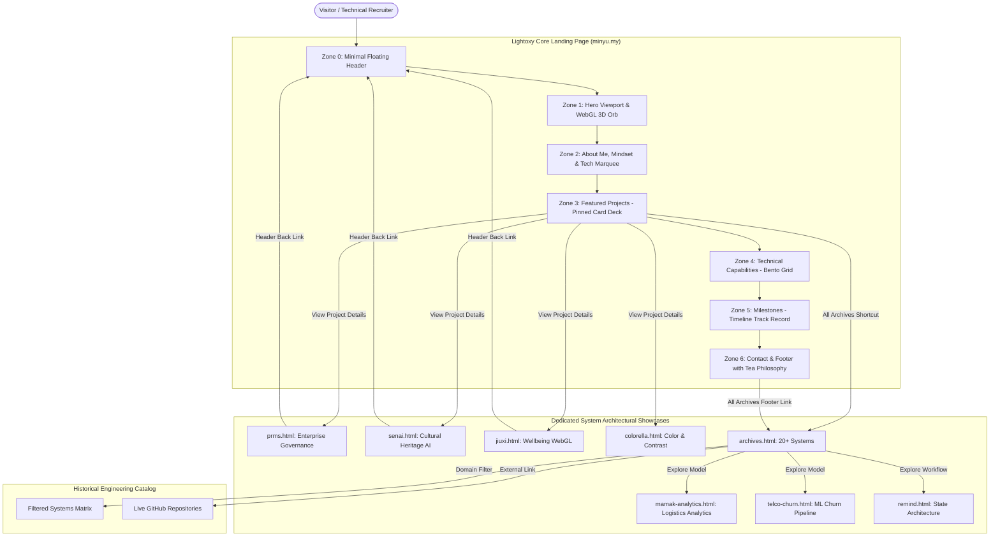

## User Flow & Navigation Architectures — Lightoxy (minyu.my)

## 1. 6-Zone Landing Page Journey



---

## 2. Traceability & System References

| Reference Target                    | Document ID                                      | Relative Path                     | Relationship Type | Relevance / Description                                          |
| ----------------------------------- | ------------------------------------------------ | --------------------------------- | ----------------- | ---------------------------------------------------------------- |
| Product Requirements Document (PRD) | [PORT-PLAN-002](../01-planning/prd.md)           | `../01-planning/prd.md`           | Contextualizes    | Upstream product capabilities, 6 zones, and navigation pathways  |
| System Use Cases                    | [PORT-REQ-003](../02-requirements/use-cases.md)  | `../02-requirements/use-cases.md` | Realizes          | Step-by-step visitor interaction workflows and state transitions |
| Component Data Flow                 | [PORT-ARCH-005](../03-architecture/data-flow.md) | `../03-architecture/data-flow.md` | Informs           | State hydration, event dispatch, and UI lifecycle mechanics      |
| Design System Specifications        | [PORT-DES-001](design-system.md)                 | `design-system.md`                | Governs           | Component visual styling, motion physics, and design tokens      |
| Responsive Breakpoints Standards    | [PORT-DES-004](responsive-breakpoints.md)        | `responsive-breakpoints.md`       | Governs           | Multi-device layout adaptation and mobile stack navigation       |

---

## 3. Granular Interaction Ergonomics

### 3.1 Zone 3: Horizontal Expanding Accordion Deck

- **Desktop Interaction (`≥ md`):**
  - Fluid height `min-h-[clamp(26rem,55vh,36rem)]`.
  - Cursor hover or keyboard focus triggers spring expansion: target card expands to `flex-[3.5]`, compressing siblings to `flex-1` via `cubic-bezier(0.16, 1, 0.3, 1)`.
  - Internal tags and case study links reveal with a staggered 150ms fade-and-lift motion.
- **Mobile Interaction (`< md`):**
  - Deck renders as a fluid vertical stack (`flex-col w-full`).
  - Cards stack with auto-height, preserving full readability and touch accessibility.

### 3.2 Zone 4: Asymmetric Bento Grid (Interactive Skill Matrix)

- **Cell 1: Backend & Data Architecture (`md:col-span-8`):** Visitor clicks between `Laravel 12`, `PostgreSQL`, `Docker`, `RBAC`, and `SQLite` pills to reveal institutional progression, relational schemas, and cryptographic SHA-256 seal governance in _PRMS_ and _ReMind_.
- **Cell 2: DevOps & Cloud Infrastructure (`md:col-span-4`):** Visitor inspects containerization and Kubernetes cluster deployment telemetry in _Traces of Senai_.
- **Cell 3: AI & Machine Learning (`md:col-span-5`):** Visitor evaluates multi-modal RAG flows (DeepSeek), neural voice synthesis (CosyVoice), and predictive modeling (XGBoost).
- **Cell 4: Frontend Engineering & WebGL (`md:col-span-7`):** Visitor inspects spatial 3D computing, modern Tailwind v4 token architecture, and fluid physics.

### 3.3 Theme Switcher

- Floating header sun/moon button toggles between deep obsidian (`#09090b`) and crisp white (`#ffffff`).
- Zero-flash inline `<head>` script ensures theme persists immediately from `localStorage` without layout shift.

---

## 4. Continuous Scroll-Driven Narrative Flow

The user journey is not fragmented into isolated page cuts; instead, the visitor experiences a choreographed visual continuity governed by the **Architectural Guide Spine**:

```mermaid
sequenceDiagram
    autonumber
    actor V as Visitor (Scroll Action)
    participant H as Zone 1: Hero 3D Orb
    participant M as Zone 2: Tech Marquee
    participant D as Zone 3: Accordion Deck
    participant B as Zone 4: Bento Skill Matrix
    participant F as Zone 6: Footer & Anchor

    V->>H: Initial Page Landing
    Note over H: Geodesic Dual-Mesh Rotates @ 60fps (Cursor Parallax)
    V->>H: Scrolls Downward
    Note over H: Orb scales & emits vertical optical guide filament
    H->>M: Guide filament intersects Zone 2 Marquee
    Note over M: Hardware-accelerated ticker active; pauses on hover
    V->>D: Scrolls into Flagship Showcase
    Note over D: Filament branches into horizontal coordinate datum track
    Note over D: 4 Flagship cards unfold with spring physics (cubic-bezier)
    V->>B: Scrolls into Bento Grid
    Note over B: Coordinate track crystallizes into 12-column hairline grid
    Note over B: Visitor clicks stack pills; context updates in < 16ms (CLS=0)
    V->>F: Scrolls to Page Base
    Note over F: Optical spine terminates at Simone Weil quote & breathing beacon
```
