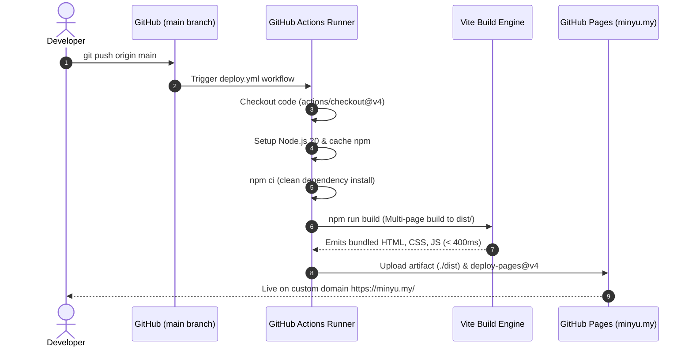

## Git Workflow & CI/CD Release Protocol — Lightoxy (minyu.my)

## 1. Branching Strategy

The repository follows a disciplined **trunk-based development** model coupled with automated GitHub Actions CI/CD deployment:

- **`main`:** The protected production trunk. All commits pushed or merged into `main` trigger automated build and deployment to `https://minyu.my/` via GitHub Actions.
- **Feature Branches (`feat/...`, `fix/...`, `docs/...`, `refactor/...`):** Short-lived working branches for isolated feature implementations, documentation enhancements, and bug fixes.
  - Branch naming convention:
    - `feat/hero-webgl-refactor`
    - `feat/bento-skill-matrix`
    - `fix/accordion-fluid-clamp`
    - `docs/update-architecture`

---

## 2. Traceability & System References

| Reference Target                    | Document ID                                               | Relative Path                               | Relationship Type | Relevance / Description                                            |
| ----------------------------------- | --------------------------------------------------------- | ------------------------------------------- | ----------------- | ------------------------------------------------------------------ |
| Documentation Standards             | [PORT-GOV-001](../DOCUMENTATION_STANDARD.md)              | `../DOCUMENTATION_STANDARD.md`              | Governed By       | Universal governance, frontmatter schema, and documentation rules  |
| Acceptance Criteria & Quality Gates | [PORT-REQ-004](../02-requirements/acceptance-criteria.md) | `../02-requirements/acceptance-criteria.md` | Enforces          | Release criteria, quality gates, and automated check thresholds    |
| System Context & Hosting Boundaries | [PORT-ARCH-002](../03-architecture/system-context.md)     | `../03-architecture/system-context.md`      | Informs           | CI/CD deployment boundaries, repository touchpoints, and edge CDN  |
| Coding Standards & Style Guide      | [PORT-DEV-001](coding-standards.md)                       | `coding-standards.md`                       | Directs           | Commit message format, Zero-Rigid-Pixels mandate, and code hygiene |
| Environment Configuration & Tooling | [PORT-DEV-002](environment-config.md)                     | `environment-config.md`                     | Complements       | npm run scripts, build commands, and multi-page configurations     |
| CI/CD Pipeline Specification        | [PORT-DEP-003](../07-deployment/ci-cd.md)                 | `../07-deployment/ci-cd.md`                 | Implements        | Automated build and GitHub Actions deployment execution            |

---

## 3. Conventional Commit Standards

Commit messages must conform strictly to the **Conventional Commits v1.0.0** specification:

$$\text{type(scope): summary}$$

### 2.1 Commit Types

- `feat`: A new user-facing capability, component, or system showcase page.
- `fix`: A defect correction (e.g. broken layout, CLS shift, contrast ratio).
- `docs`: Documentation updates or additions under `docs/` governed by `PORT-GOV-001`.
- `style`: Visual styling, Tailwind utility adjustments, or formatting without logic change.
- `refactor`: Structural reorganization without changing user-facing behavior.
- `perf`: Performance optimization (e.g. Three.js `IntersectionObserver` gating, sub-300ms builds).
- `chore`: Tooling, dependency updates (`package.json`, `vite.config.js`), or build scripts.

### 2.2 Approved Scopes

- `hero`: Zone 1 Hero stage, 3D WebGL orb, typography.
- `about`: Zone 2 About Me perspective cards & tech marquee.
- `deck`: Zone 3 Featured projects pinned accordion deck.
- `bento`: Zone 4 Asymmetric 12-Column Bento Grid (Interactive Skill Matrix).
- `milestones`: Zone 5 Track record and milestone timeline.
- `contact`: Zone 6 Contact hub & grounded footer.
- `archives`: Standalone historical project catalog (`archives.html`).
- `nav`: Minimal floating glass header and spine waypoint navigator.
- `vite`: Build toolchain, Rollup bundling, and Vite plugins.
- `ci`: GitHub Actions workflows and deployment configurations.
- `seo`: Schema.org JSON-LD, sitemaps, robots.txt, and meta tags.

---

## 4. GitHub Actions Automated CI/CD Pipeline

Production deployments are fully automated via **`.github/workflows/deploy.yml`**:



---

## 5. Pre-Commit & Pre-Push Quality Verification Checklist

Before pushing any commit to `main`, execute the following quality gates locally:

```powershell
# 1. Build and verify all 9 HTML entry points with Vite (< 400ms target)
npm run build

# 2. Validate documentation integrity and frontmatter governance
node scratch/validate_docs.js

# 3. Check for zero occurrences of retired moniker
node scratch/check_miu.js

# 4. Preview the production build locally
npm run preview
```

### Mandatory Checks

- [ ] `npm run build` completes in `< 400ms` with zero Rollup compiler errors.
- [ ] All 39 documentation files pass `validate_docs.js` with 0 errors.
- [ ] Zero occurrences of the retired moniker confirmed across the codebase.
- [ ] `CNAME` file contains `minyu.my` and `.nojekyll` exists in root.
- [ ] `sitemap.xml` contains all active routes with valid `<lastmod>`.
